  I build PS2 homebrew tooling, UI and themes, make noise on the side, and fix hardware for fun.

  
  
  

  <a href="https://nathanneurotic.github.io/RiptOPL-Themes/">community themes</a> ·
  <a href="https://nathanneurotic.com">site</a> ·
  <a href="mailto:contact@nathanneurotic.com">email</a>
    
  perks ↴&nbsp;
  <a href="mailto:contact@nathanneurotic.com?subject=Requesting%20ChatGPT%20Referral%20Code%20from%20Github">ChatGPT</a> ·
  <a href="https://claude.ai/">Claude</a> ·
  <a href="https://coderabbit.link/nathan-neurotic-ripto">CodeRabbit</a> ·
  <a href="https://g.co/g1referral/5HBQ6VSH">Antigravity</a> ·
  <a href="https://www.kimi.ai/activities/en/invite/share?scenario=subscribe&amp;from=share_poster&amp;invitation_code=UHDDN5">Kimi</a> ·
  <a href="https://suno.com/invite/@nathanneurotic">Suno</a>

